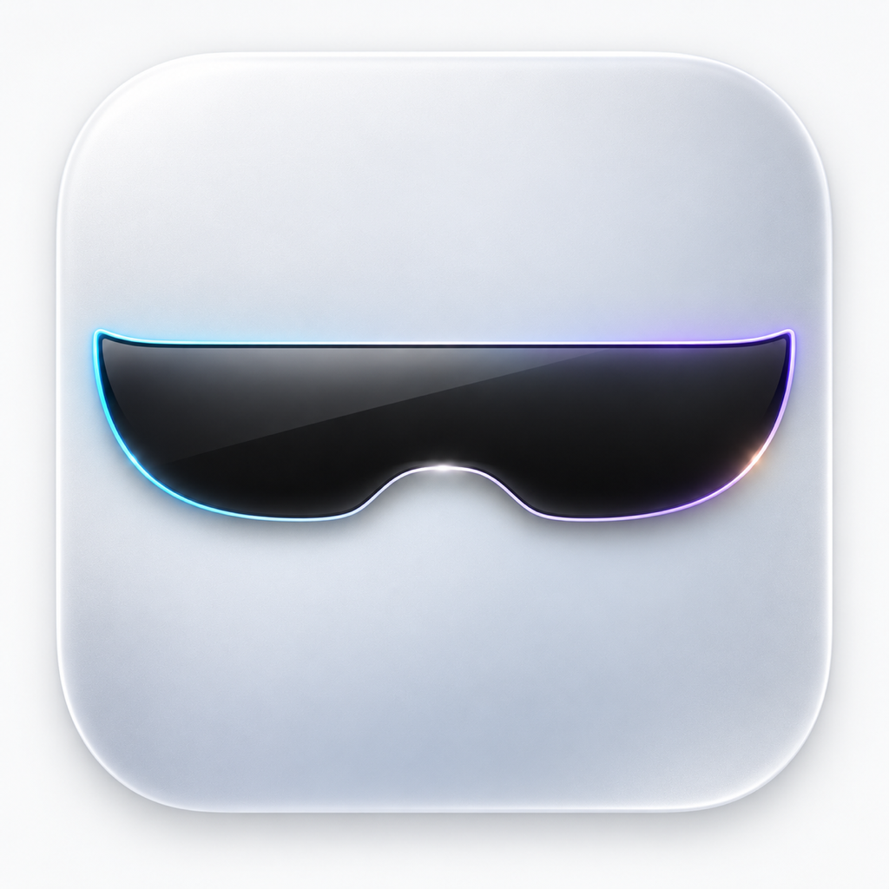

# build 145：统一墨镜 Logo

顶屿采用确认的深色玻璃墨镜标志：低矮横向轮廓，两侧轻微上挑，中央鼻梁切口，镜面带一道斜向反光与青紫细光。它保留顶屿的横向岛形，也让品牌更有辨识度。

## 替换范围

- 应用图标主图为 1024 × 1024 PNG；ICNS 包含 16、32、128、256、512pt 及对应 Retina 规格。
- Finder、候选安装包和设置“关于”页读取同一个应用图标。
- 菜单栏使用相同墨镜轮廓的单色光学简化版，由 macOS 模板着色适配深浅背景。
- README 直接引用新的主图，不重复维护另一份品牌图片。

历史截图、录屏和过去开发日志保留原样，不把旧版运行记录伪装成新版截图。系统原生播放图标和第三方音乐 App 徽标也不替换成顶屿标志。

本次同步源码和开发日志，不发布新下载版。公开 Release v0.1.1-alpha.4 保持原文件；新版 Logo 随当前源码或后续经授权的 Release 提供。
